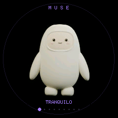
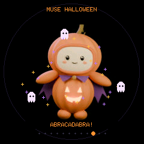
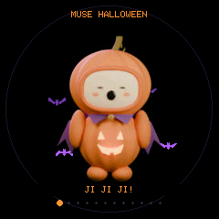
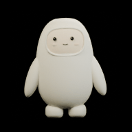

# MuseDial 🎃

[English](README.en.md) · [Instalar](docs/INSTALL.md) · [Compilar](docs/BUILD.md) · [Controles](docs/CONTROLS.md)

Creé **MuseDial** porque quería darle vida a mi **M5Stack Dial** con un compañero animado inspirado en Muse. Empecé con el personaje y fui añadiendo caricias, modo Halloween, murciélagos, cosquillas y hechizos que cargas girando la rueda. Funciona completamente **sin conexión**, sin cuenta, token, micrófono ni bocina.

Comparto el código, las animaciones y las herramientas para que puedas instalarlo en tu Dial, modificarlo y aportar tus propias ideas. En estas guías documento cómo lo construí y qué pude comprobar en mi equipo.

Desarrollo este proyecto de forma independiente, inspirado visualmente en Muse. No estoy afiliado a Meta ni a M5Stack, y MuseDial no es un producto oficial. No incluye los servicios, modelos de IA ni aplicaciones de Muse.

## Más cariño en el modo normal

Añadí miradas que siguen nueve zonas de la pantalla, caricias progresivas, un abrazo y cosquillas. Toca sin presionar el botón mecánico; los [controles](docs/CONTROLS.md) explican los tiempos de cada gesto.

## Lo que necesitas

- M5Stack **Dial**, basado en Stamp-S3 / ESP32-S3, flash de 8 MiB y sin PSRAM.
- Pantalla táctil circular integrada de 240 × 240, rueda y botón integrados.
- Cable USB-C **de datos** y un computador con Windows, Linux o macOS. Alimentación por USB; no hay cableado ni periféricos adicionales.
- Python 3.12 para instalar binarios; Git y Arduino CLI 1.5.1 para compilar. Blender 5.2.1 solo si quieres regenerar las animaciones.

Para las pruebas físicas utilicé mi **M5Stack Dial original**; no he validado otras placas. Detectar un ESP32-S3 de 8 MiB no identifica automáticamente la pantalla ni los pines de otras placas. [Ficha oficial del equipo](https://docs.m5stack.com/en/core/Dial).

## Comenzar

1. Descarga y extrae el ZIP de la [última release](https://github.com/Khiggins93/musedial/releases/latest).
2. Sigue la [guía de instalación y respaldo](docs/INSTALL.md). El instalador guarda un respaldo privado completo antes de escribir.
3. Arranca en Muse normal. Mantén el botón **más de tres segundos** para activar Halloween.

También puedes [compilar desde las fuentes](docs/BUILD.md), sin instalar Blender: el repositorio incluye los recursos finales.

## Interacciones

| Acción | Resultado |
|---|---|
| Mantener más de 3 s | Alternar normal/Halloween una vez; despertar y activar automático |
| Soltar entre 1 y 3 s | Alternar reposo |
| Pulsación breve | Alternar automático; si estaba dormido, solo despertar |
| Rueda | Elegir expresión; en Halloween vuelve al automático tras 10 s |
| Toque y deslizamiento suave | Sigue tu dedo con la mirada en normal; al soltar, caricia |
| Caricias normales sucesivas | Sonrisa, cariño y abrazo; contacto táctil de 2 s para abrazo directo |
| Un toque en Halloween | Cuatro murciélagos |
| Tres toques rápidos | Cosquillas en ambos temas |
| Elegir HECHIZO, girar 8 pasos adicionales y pulsar | Destellos y tres fantasmitas durante 6 s |

[Detalles, excepciones y comandos USB](docs/CONTROLS.md). Incluye nueve expresiones normales y doce Halloween. No guarda preferencias de interacción en flash: tras reiniciar vuelve a normal.

## Cómo funciona

Blender genera secuencias de 192 × 192, a 20 cuadros/s. El firmware decodifica JPEG por bloques sin PSRAM; dibuja partículas y sprites sobre el personaje. Halloween ocupa una partición de recursos que sustituye al segundo slot de aplicación. **No hay actualización OTA**. Si los recursos Halloween son inválidos, el tema normal continúa funcionando.

[Arquitectura y memoria](docs/ARCHITECTURE.md) · [Procedencia de recursos](docs/ASSETS.md) · [Validación](docs/VALIDATION.md) · [Contribuir](CONTRIBUTING.md) · [Cambios](CHANGELOG.md).

## Licencia

Comparto el código propio bajo [Apache 2.0](LICENSE). Consulta [NOTICE](NOTICE) y [avisos de terceros](THIRD_PARTY_NOTICES.md). La licencia no concede derechos sobre marcas o personajes de terceros. No distribuyo aquí las fotografías externas de referencia ni los recursos originales del SDK.
