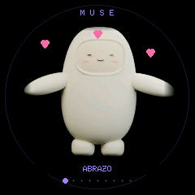
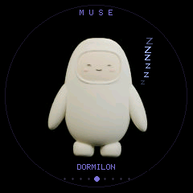
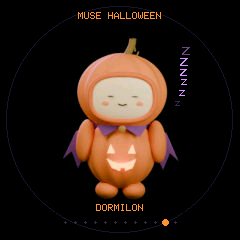

# Validación / Validation

Here I document the results measured on my Dial separately from automated build checks. For the public version, I kept the animation assets and interaction state machines from my private 3.1 baseline and removed the unused SDK pixel renderer.

## Baseline 3.1 (not a new public-build measurement)

On the original M5Stack Dial: 93 functional regression checks, five minutes alternating spells/tickles, 19.874–19.980 fps, 218592 bytes free heap throughout, zero decode errors. Physical controls were confirmed on earlier versions; USB simulations are not physical confirmation of this public build.

## Community 3.1.1

I collected these measurements on 2026-10-12 (America/Bogota), using the Windows-built community application on my original M5Stack Dial:

| Check | Result |
|---|---|
| USB hardware regression | 74 checks passed: all 9 normal/12 Halloween expressions, effects, brightness, sleep and input selftests |
| Timed coverage | 30 seconds normal + 30 seconds Halloween; captures excluded |
| Frame rate | 19.549–19.994 fps |
| Free heap | 219104 bytes, constant throughout the measured intervals |
| Maximum frame draw | 40609 microseconds |
| Decoder errors / restarts during the test | 0 / 0 |
| Blender preview regeneration | 9 normal + 12 Halloween images at 192 × 192 |
| Local host tests | 13 passed, native C++ test skipped because g++ was unavailable |
| Clean Linux GitHub Actions | All 14 tests passed, including C++ input boundaries; build and package verification passed |
| Extracted release ZIP | Every SHA256SUMS entry and standalone installer verification passed |

The 8 MiB original flash was backed up and compared against the device digest before installation. Large native USB read bursts stalled during initial attempts, before any write; the published installer uses sector-sized reads, per-read esptool digest validation, identity-checked reconnects and a final whole-flash digest. Unit tests cover reconnect interruption and wrong-device rejection. Release notes record the final restoration exercise.

The repository test suite validates resource checksums, corrupt/truncated images, offset bounds, exact layouts, manifest path/offset rejection, device-bound backups, palette preservation and the C++ input state machines. A host without g++ skips only the native C++ test; the device selftests and Linux CI cover it separately.

These are USB/software checks on real hardware, not a new physical-user confirmation of wheel/touch/button operation. The longer five-minute baseline measurement above belongs to 3.1 and is not attributed to this public build. Windows hardware flashing and Linux clean compilation were verified; macOS hardware operation was not tested.

I have excluded raw local logs, device identifiers, flash backups and personal paths from the repository. You can inspect the CI workflow output in the public Actions tab.

## Companion 3.2.0

Para esta versión probé el firmware compilado en Windows en mi Dial el
2026-10-12 (America/Bogota). Conservé un respaldo completo verificado de la
flash anterior antes de instalarlo.

| Comprobación | Resultado |
|---|---|
| Regresión de ambos temas | 74 comprobaciones USB correctas |
| Interacciones nuevas | 21 comprobaciones funcionales: miradas, progresión, abrazo, cosquillas, expiración y cancelación |
| Prueba continua adicional | Bucle de 300 s; 115 muestras, sin capturas durante la medición |
| Fluidez durante la prueba | 19.504–19.735 fps |
| Memoria libre | 219072 bytes, constante |
| Errores de decodificación / reinicios durante las pruebas | 0 / 0 |
| Recursos nuevos | 145 JPEG válidos, 661926 bytes; hash fijado en dependencias |
| Aplicación Windows instalada | 2866272 bytes de una partición de 3342336 bytes |
| CI Linux | 15 pruebas, compilación y verificación del paquete correctas |

El CI del código probado está disponible en
[GitHub Actions](https://github.com/Khiggins93/musedial/actions/runs/38303272701).
En Windows, 14 pruebas de host pasaron y la prueba C++ se omitió por falta de
compilador nativo; sí pasó en Linux y como `selftest companion` en el dispositivo.

Estas comprobaciones automatizadas usan USB. Además, confirmé físicamente que
la mirada sigue el dedo y que mantener el contacto y soltar activa el abrazo.
Las demás interacciones nuevas de esta tabla se comprobaron por USB. La primera
consulta USB inmediatamente después de flashear agotó su tiempo de espera;
las pruebas posteriores confirmaron el arranque y no observaron reinicios.

I measured the same results above on my original Dial: 74 existing regression
checks, new companion interaction checks and a separate five-minute automated
run. I also physically confirmed gaze tracking and the hold/release hug.
This is not a new 30-minute soak; the remaining new interactions were tested over USB.
The gaze uses nine discrete rendered poses. Finite gesture clips ease in/out;
transitions from arbitrary base expressions are not cross-faded.

## Dreams 3.2.1

Probé las Z de sueño en mi Dial el 2026-10-12 (America/Bogota): pasaron
22 comprobaciones USB, incluidas las cuatro expresiones, la ocultación durante
caricias/reposo y su reaparición. Medí cuatro intervalos de diez segundos,
sin capturas durante la medición: **19,610–19,727 fps**, **219072 bytes libres
constantes**, cero errores de decodificación y cero reinicios observados.
La aplicación instalada ocupa 2866992 bytes. El respaldo completo anterior se
verificó antes de escribir. Las 15 pruebas, compilación y verificación del paquete
pasaron en [CI Linux](https://github.com/Khiggins93/musedial/actions/runs/38305824206).

Estas imágenes son capturas reales del framebuffer del dispositivo:

I verified all four sleepy expressions, effect cancellation and recovery through
22 USB checks. Four ten-second measurement windows yielded 19.610–19.727 fps,
constant free heap and no observed decoder errors or resets. These results are
separate from the five-minute 3.2 measurements above.
